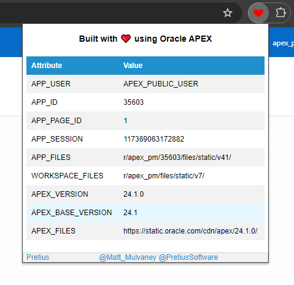
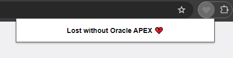

# Built with ❤️ using Oracle APEX

## Overview
**Built with ❤️ using Oracle APEX** is a Chrome extension that displays a red heart and additional information on webpages built with Oracle APEX. 

For pages not using Oracle APEX, it displays a heartbroken message.

## Features
- Detects if a webpage is built with Oracle APEX.
- Displays a red heart and information on Oracle APEX pages including the APEX version
- Shows the APEX version (e.g. `26.1`) on the toolbar icon
- Shows the Universal Theme version
- Detects APEX apps embedded in iframes
- Copy the page's APEX info as JSON or a Markdown table
- Share an APEX site on LinkedIn (only the site's address is shared, never the full URL, which can contain a session ID)
- **Hearts collected** (opt-in): counts the Oracle APEX sites you visit. Site names are encrypted (AES-GCM) and stored only on your device; private browsing is never recorded. Share your heart count on LinkedIn.
- Light and dark mode
- Available in English, Polish, Dutch, German, Spanish and French
- Shows a heartbroken emoji with a randomised sad message for non-Oracle APEX pages.

## Screenshots




## Installation
1. **Install from Chrome Web Store**:
   - Visit the [Chrome Web Store](https://chromewebstore.google.com/detail/built-with-love-using-ora/bhlkijnameeejlifhlmhcfjgmigdpjae) and click on "Add to Chrome".
   
2. **Pin to Taskbar**:
   - After installation, right-click on the extension icon in the Chrome toolbar.
   - Select "Pin" to keep it handy in your taskbar.

## Usage
1. Navigate to any webpage.
2. The extension icon will change based on whether the page is built with Oracle APEX:
   - Red heart icon for Oracle APEX pages.
   - Grey heart icon for non-Oracle APEX pages.
3. Click on the extension icon to see additional information on APEX pages

## Test it out 
- [Cards](https://apex.oracle.com/go/sample_cards)

- [Charts](https://apex.oracle.com/go/sample_charts)

- [Maps](https://apex.oracle.com/go/sample_maps)

- [PWA (Progressive Web App)](https://apex.oracle.com/go/pwa)

- [Universal Theme](https://apex.oracle.com/ut)

## Development

The extension lives in `src/` and has no build step. Load it in Chrome with **Load unpacked** on `chrome://extensions`, choosing the `src` folder.

```
npm ci
npm run lint
npm run check-locales
```

Translations are in `src/_locales/<lang>/messages.json`. `check-locales` fails if any language is missing a message that English has.

## Releasing

Releases publish automatically. Bump `version` in `src/manifest.json`, add a Release History entry, commit, then push a matching tag:

```
git tag v26.2.0
git push origin v26.2.0
```

The **Release** workflow then runs the checks, confirms the tag matches the manifest version, zips `src/`, uploads it to the Chrome Web Store, submits it for review, and creates a GitHub release with the zip attached.

### One-time setup (Chrome Web Store API v2)

Publishing signs in with a Google Cloud **service account**. The publisher (the Google account that owns the extension in the Developer Dashboard) needs to:

1. In [Google Cloud Console](https://console.cloud.google.com), pick or create a project and enable the **Chrome Web Store API** (APIs & Services > Library).
2. Go to **IAM & Admin > Service Accounts > Create service account**. Give it a name; don't grant it any roles.
3. Open the service account, go to **Keys > Add key > Create new key > JSON**. A key file downloads.
4. In the [Chrome Web Store Developer Dashboard](https://chrome.google.com/webstore/devconsole), open **Account**, and add the service account's email address (ends in `.iam.gserviceaccount.com`). Only one service account can be added per publisher.
5. Copy the **Publisher ID** from the Developer Dashboard (Account / Settings).
6. Add these repository secrets in GitHub (Settings > Secrets and variables > Actions):
   - `CWS_SERVICE_ACCOUNT_KEY`: the entire contents of the JSON key file
   - `CWS_PUBLISHER_ID`
7. Delete the downloaded key file from your computer.

The publisher's Google account needs 2-step verification. See [Use a service account with the Chrome Web Store API](https://developer.chrome.com/docs/webstore/service-accounts).

The publish script also still accepts an OAuth refresh token instead (`CWS_CLIENT_ID`, `CWS_CLIENT_SECRET`, `CWS_REFRESH_TOKEN`), but that needs a published OAuth consent screen, which isn't practical for a personal account.

# Release History

26.2.0 : November 2026
* APEX version shown on the toolbar icon
* Universal Theme version shown in the popup
* Detects APEX apps embedded in iframes
* Copy APEX info as JSON or Markdown
* Share a site, or your heart count, on LinkedIn
* Hearts collected: opt-in, encrypted, on-device count of APEX sites visited
* Dark mode
* Translations: Polish, Dutch, German, Spanish, French
* Author and company links now go to LinkedIn
* Automated release to the Chrome Web Store on version tags
* Popup now checks the page when opened, so tabs open before install/update are detected
* Icon is set per tab (fixes wrong icon with multiple windows)
* Security: page-supplied values are rendered as text, never HTML
* Detection runs via `chrome.scripting` in the page's main world; no more content script, injected script, DOM attributes or web-accessible resources
* Removed unneeded `activeTab` permission; requires Chrome 102+
* Popup shows extension version; footer layout fixed

24.1.1 : July 2024
* Initial Version

## Built with ❤️ using Oracle APEX

- Author: [Matt Mulvaney](https://www.linkedin.com/in/matt-mulvaney-541a659/)

- Low-Code: [Pretius](https://www.linkedin.com/company/pretius)